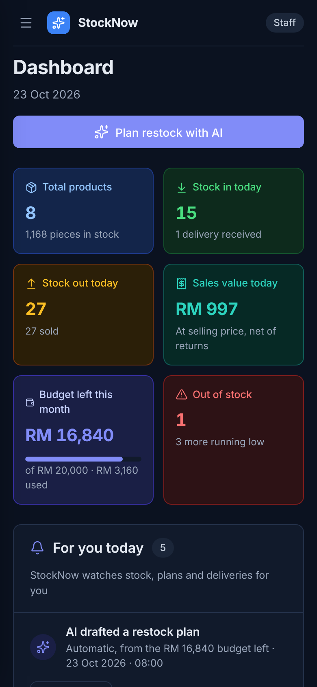

# StockNow

> An inventory app with an AI restock planner that tells small clothing shop owners what to buy, how much, and why, within their monthly budget. The AI suggests; the owner decides.

<p align="center">
  
  &nbsp;
  
</p>

---

## Team Information

| Field                 | Details                                                                                     |
| --------------------- | ------------------------------------------------------------------------------------------- |
| **Team Name**         | Kita Akan Lawan                                                                             |
| **Team Domain**       | Domain 2 (Orbyte Smart SME Challenge: Less Busywork, Better Business)                       |
| **SDG Track**         | SDG 8 (Decent Work and Economic Growth) and SDG 9 (Industry, Innovation and Infrastructure) |
| **Team Leader**       | Alfred Jason Gustono                                                                        |
| **University**        | Xiamen University Malaysia                                                                  |
| **Number of Members** | 5                                                                                           |

## Links

| Resource           | Link                                       |
| ------------------ | ------------------------------------------ |
| GitHub Repository  | https://github.com/AlfredJason78/test-file |
| Live Demo (Replit) | _Add the Replit deployment link_           |
| Slide Deck         | _Add link_                                 |
| Demo Video         | _Add link_                                 |

---

## Overview

### Problem

Small shops keep stock, sales and purchasing in separate places: a notebook, a spreadsheet, WhatsApp chats. Every restock means counting items again, guessing what will sell, and checking by hand whether the order fits the money set aside. Guess too low and best-sellers run out; guess too high and cash sits on the shelf as unsold stock. Malaysian MSMEs produce 39.5% of the country's GDP and 48.7% of its jobs (DOSM, 2024), so wasted time and wasted cash here matter.

### Solution

StockNow keeps stock in, stock out, suppliers and the monthly purchase budget in one place. Its **AI Restock planner** then:

1. **Forecasts** each product's sales for the next 30 days from 6 months of history (a weighted moving average blended with a trend line).
2. **Works out** how many to buy (forecast + safety stock − stock on hand − stock already on order), checks margin and overstock, and **fits the plan into the budget** by urgency and profit.
3. **Explains** every decision in plain words, with expected profit, return on investment and a confidence score. A **Show calculation** view lays out every step of the maths, and an **Accuracy check** backtests the forecast against the latest real month.
4. **Hands the decision to people.** Staff send the plan; the Owner or a Manager approves or rejects each item. Approved items become one order per supplier, and **Gemini** drafts the WhatsApp message.

The numbers come from StockNow's own engine, so they are repeatable and testable. Gemini only writes the wording. If a Gemini reply contains a number the engine did not produce, StockNow discards it and uses a template instead.

### Key Features

- **AI Restock planner:** buy / wait / don't-buy for every product, fitted to the budget, with reasons, profit, ROI and confidence.
- **Show calculation and Accuracy check:** every number can be traced, and the forecast is backtested on the shop's own sales.
- **Approval workflow:** Staff send, Owner/Manager approve per item. Nothing is ordered without a person.
- **Supplier orders on WhatsApp:** one order per supplier, a message drafted by Gemini, chasing late deliveries, and receiving partial deliveries.
- **Automatic triggers:** a low-stock alert after a stock out, a monthly plan drafted on the plan day, and a daily late-delivery check.
- **Budget that adds up:** supplier orders and manual purchases use it; returns to a supplier refund it; customer returns reduce the day's sales.
- **Roles:** Owner, Manager and Staff. Permissions are checked on the server, not only in the UI.
- **Outage plan:** offline stock entry that syncs later, a backup copy, and paper/WhatsApp catch-up entry.
- **Six demo scenarios:** mixed, growing, slow season, festive rush, viral product and overstocked, to show how the AI reacts.
- **Responsive:** a sidebar on desktop, a drawer menu and stacked cards on phones, plus light and dark mode.

### Tech Stack

| Layer         | Technology                                                                                                            |
| ------------- | --------------------------------------------------------------------------------------------------------------------- |
| Frontend      | Next.js 15 (React 19), JavaScript, plain CSS, lucide-react icons                                                      |
| Backend       | Next.js API routes (Node.js); restock engine in plain JavaScript (`lib/engine.js`)                                    |
| Database      | Supabase (PostgreSQL), with a built-in in-memory demo store when Supabase is not configured                           |
| AI            | Google Gemini API (`gemini-3.8-flash` by default, set with `GEMINI_MODEL`) for wording only, with a template fallback |
| Hosting / Dev | Replit                                                                                                                |
| Tests         | Vitest                                                                                                                |

---

## Project Structure

```
.
├── src/
│   ├── app/
│   │   ├── layout.js               # HTML shell, fonts, viewport
│   │   ├── page.js                 # Renders the app
│   │   ├── globals.css             # Design tokens (light/dark) and responsive layout
│   │   └── api/
│   │       ├── state/route.js      # GET the whole shop
│   │       ├── action/route.js     # POST one action (stock in/out, approve, …)
│   │       └── ai/
│   │           ├── summary/route.js  # Gemini: plan summary
│   │           └── message/route.js  # Gemini: supplier WhatsApp message
│   ├── components/
│   │   ├── App.jsx                 # State, API calls, offline mode, sidebar
│   │   ├── Modals.jsx              # Forms, approvals, WhatsApp, Show calculation
│   │   ├── ui.jsx                  # Icons, chips, selects, sparkline
│   │   └── pages/                  # Dashboard, Products, Stock In/Out, Suppliers,
│   │                               # AI Restock, Approvals, Activity Log, Team, Settings
│   └── lib/
│       ├── engine.js               # AI engine: forecast, plan, budget, backtest
│       ├── actions.js              # Every change + permission checks (server and offline)
│       ├── seed.js                 # Synthetic demo shop and 6 scenarios (the AI's sales data)
│       ├── messages.js             # Supplier message templates
│       ├── format.js               # Money, dates, helpers
│       └── server/
│           ├── store.js            # Supabase or in-memory storage, write lock
│           ├── tables.js           # App fields ↔ Postgres columns
│           ├── gemini.js           # Gemini call + number guard + fallback
│           └── http.js
├── supabase/schema.sql             # Tables, checks and row-level security (paste into Supabase)
├── tests/                          # Engine, actions and storage tests
├── docs/
│   ├── architecture.png            # System block diagram
│   └── screenshots/                # Desktop and phone screenshots
├── submission/                     # Required submission documents
├── .env.example                    # Environment variables
├── .replit                         # Replit run and deployment configuration
├── jsconfig.json                   # "@/…" import alias → src/
├── LICENSE
├── package.json
└── README.md
```

### Architecture

```
Browser (phone / desktop)
        │  HTTPS
        ▼
Replit ── Next.js app ── API routes ── restock engine (lib/engine.js)
                │                 │
                │                 └──► Google Gemini API  (wording only; template if unavailable)
                ▼
        Supabase PostgreSQL  (or the built-in demo store)

Supplier messages open in WhatsApp (wa.me link); a person sends them.
Orbyte Directory, eLeave, notifications and Payment are shown as integration points (simulated in the demo).
```


---

## How to Run

StockNow runs **without any keys**: it uses the built-in demo shop and template text. Add Supabase to keep data permanently, and Gemini for AI-written text.

### Option 1: Run on Replit (recommended)

1. In Replit, choose **Create Repl → Import from GitHub** and paste this repository's URL.
2. _(Optional)_ Open **Secrets** (🔒) and add the variables from `.env.example`:
   - `GEMINI_API_KEY`: from [Google AI Studio](https://aistudio.google.com/apikey)
   - `SUPABASE_URL` and `SUPABASE_SERVICE_ROLE_KEY`: see _Connect Supabase_ below
3. Click **Run**. Replit uses `.replit` to run `npm install && npm run dev`, and the app opens in the Webview on port 3000.
4. To publish, open **Deploy → Autoscale**. Replit builds with `npm run build` and starts with `npm run start`.

> Without Supabase, the demo data lives in server memory and resets when the Repl restarts or scales. Connect Supabase for a deployment that keeps its data.

### Option 2: Run locally

Requires **Node.js 20 or newer**.

```bash
# 1. Clone the repository
git clone https://github.com/AlfredJason78/test-file.git stocknow
cd stocknow

# 2. Install dependencies
npm install

# 3. (Optional) Configure environment variables
cp .env.example .env.local      # then fill in your keys

# 4. Start the app
npm run dev                     # open http://localhost:3000
```

Production build: `npm run build` then `npm run start`.

### Connect Supabase (optional)

1. Create a project at [supabase.com](https://supabase.com).
2. Open **SQL Editor**, paste the contents of [`supabase/schema.sql`](supabase/schema.sql), and run it.
3. Go to **Project Settings → API**. Copy the **Project URL** into `SUPABASE_URL` and the **service_role** key into `SUPABASE_SERVICE_ROLE_KEY`.
4. Restart the app. On first start it fills the empty tables with the demo shop. Settings → Backup then shows **Supabase connected**.

The service_role key is only used on the server (API routes). The browser never talks to Supabase, and row-level security is on, so the public anon key can read nothing.

### Run Tests

```bash
npm test
```

25 tests cover the forecast and plan (for example: Hoodie needs 191, confidence 94%, the plan never goes over budget), the budget rules, approvals and permissions, offline mode, the Gemini number guard, and the Supabase storage path (against a fake client).

### Try the demo

There is no login page. Use the **account switcher** at the bottom of the sidebar:

1. As **David Lee (Staff)**: Dashboard → **Plan restock with AI** → review the plan → **Send to Approval**.
2. Switch to **John Tan (Owner)**: Approvals → **Approve & create orders** → **Send order** → **Open in WhatsApp**.
3. Stock In → Supplier orders → **Receive stock** when it "arrives".
4. AI Restock → **Accuracy check**, or change **Demo data** to see the AI react to a festive rush or an overstocked shop.

### Setup guide

**Dependencies.** Only Node.js is needed (version 20 or newer; Replit uses Node.js 22). `npm install` installs everything listed in `package.json`; nothing has to be installed one by one:

| Package                 | Version | Used for                           |
| ----------------------- | ------- | ---------------------------------- |
| `next`                  | 15.5.28 | Web framework (pages + API routes) |
| `react`, `react-dom`    | 19.2.0  | User interface                     |
| `lucide-react`          | 0.555.0 | Icons                              |
| `@supabase/supabase-js` | 2.117.0 | Database client                    |
| `vitest` _(dev only)_   | 3.2.7   | Tests                              |

**What goes into Supabase.** Only [`supabase/schema.sql`](supabase/schema.sql): paste the whole file into Supabase → SQL Editor → Run, once. Do not insert data by hand. On first start the app sees empty tables and fills them with the demo shop.

**Where the AI's data lives.** The 6 months of sales the forecast uses, the products, prices, stock and suppliers all come from [`src/lib/seed.js`](src/lib/seed.js) (synthetic). With Supabase connected they are copied into the tables (`sales_history`, `products`, …) and read from there. The AI's rules (safety stock 20%, overstock after 45 days, minimum margin 25%, …) are in `ENGINE` at the top of [`src/lib/engine.js`](src/lib/engine.js). You don't need to touch either file. To try other sales stories, use **Settings → Demo data** or the **Demo data** menu on the AI page.

**Gemini model.** The default is `gemini-3.8-flash`, Google's recommended Flash model. Set `GEMINI_MODEL` to use another one (for example `gemini-3.5-flash-lite`). Gemini 2.5 models are not available to new API keys.

**The `.replit` file.** Replit reads it automatically; you don't run it yourself.

| Line                                 | What it does                                                                      |
| ------------------------------------ | --------------------------------------------------------------------------------- |
| `modules = ["nodejs-22"]`            | Gives the Repl Node.js 22                                                         |
| `run = "npm install && npm run dev"` | What the **Run** button does: install packages, start the dev server on port 3000 |
| `[deployment] build`                 | What **Deploy** runs first: `npm ci && npm run build`                             |
| `[deployment] run`                   | How the deployed app starts: `npm run start`                                      |
| `deploymentTarget = "autoscale"`     | Deployment type (scales to zero when idle)                                        |
| `[[ports]] 3000 → 80`                | Makes the app reachable on the public URL                                         |

**Deploy to Replit, step by step.**

1. Push this project to GitHub.
2. Replit → **Create Repl → Import from GitHub** → choose the repository. Replit detects `.replit`.
3. **Tools → Secrets**: add `GEMINI_API_KEY`, `SUPABASE_URL` and `SUPABASE_SERVICE_ROLE_KEY` (and `GEMINI_MODEL` if you want a different model).
4. Press **Run** and check the Webview. Settings → Backup should say **Supabase connected**; the AI page should say **Written by Gemini**.
5. Press **Deploy → Autoscale → Deploy**. Add the Secrets to the deployment too if Replit asks. Copy the `.replit.app` link into _Links_ above.

**Check the versions you are using.**

```bash
node -v                      # Node.js
npm -v                       # npm
npx next --version           # Next.js
npm ls next react react-dom lucide-react @supabase/supabase-js vitest
```

`npm ls` prints the exact installed version of each package. The versions requested are in `package.json`, and the exact ones are pinned in `package-lock.json`.

---

## How We Use Replit _(Required)_

- **Hosting:** The app is deployed with Replit Deployments at the Live Demo link above. `.replit` defines the run command for development (`npm run dev`) and the build/start commands for the deployment.
- **Secrets:** `GEMINI_API_KEY`, `SUPABASE_URL` and `SUPABASE_SERVICE_ROLE_KEY` are stored in Replit Secrets, never in the code or the repository.

📄 Proof of use: [`submission/SDC2026_KitaAkanLawan_Replit_POU.pdf`](submission/SDC2026_KitaAkanLawan_Replit_POU.pdf)

---

## Challenges & Learnings

- **Finding a gap Orbyte had not filled.** Our first few ideas were good, but they already existed in some form in the Orbyte ecosystem (eLeave, eClaim, eOT, Attendance, Directory). We learned to study the platform first and to build something that **plugs into** Orbyte instead of rebuilding it.
- **Standing out.** Our mentor pointed out that there is already a lot of software out there, so standing out is hard. It took a lot of brainstorming to land on a clear angle: an AI that explains its numbers and leaves the decision to the owner.
- **Teamwork.** We learned to divide the work better and to manage our time, so design, building, testing and the pitch could move forward in parallel.

## Future Improvements

- [ ] Better integration with Orbyte: real Directory sign-in, eLeave-aware approvals, notifications and Payment for supplier orders
- [ ] Connect to store and marketplace APIs (POS, Shopee, TikTok Shop) so sales flow in automatically
- [ ] Seasonality in the forecast (festive periods such as Raya and year-end sales)
- [ ] Sign-in with row-level security before handling real shop data

## Team

| Name                     | Role                         | GitHub                                             |
| ------------------------ | ---------------------------- | -------------------------------------------------- |
| Alfred Jason Gustono     | Team Lead / Full Stack       | [@AlfredJason78](https://github.com/AlfredJason78) |
| Bartolomeo Arcka Malta   | Full Stack / Pitch Presenter | [@Albread](https://github.com/Albread)             |
| Valent Budi Prayogo      | Lead Tester                  | [@PrayogoValent](https://github.com/PrayogoValent) |
| Sternt Harbent Chang     | Documentation                | [@Sternt](https://github.com/Sternt)               |
| Nicholas William Soesilo | Pitch Designer               | [@nikuniku06](https://github.com/nikuniku06)       |

---

## Submission Checklist

- [x] Team name, domain (Domain 2) and SDG track filled in
- [ ] Slide deck link added
- [ ] Demo video link added
- [ ] Replit used, with proof of use in `submission/`
- [x] Preliminary submission completed (`SDC2026_KitaAkanLawan_Preliminary.pdf`)
- [x] Technology declaration completed (`SDC2026_KitaAkanLawan_TechDeclaration.pdf`)
- [x] Submission files renamed with the team name
- [x] "How to Run" steps verified
- [x] No API keys or secrets committed to the repository

## License

This project is licensed under the [Apache License 2.0](LICENSE).

_All shop data in this repository (people, suppliers, phone numbers, sales) is synthetic._
