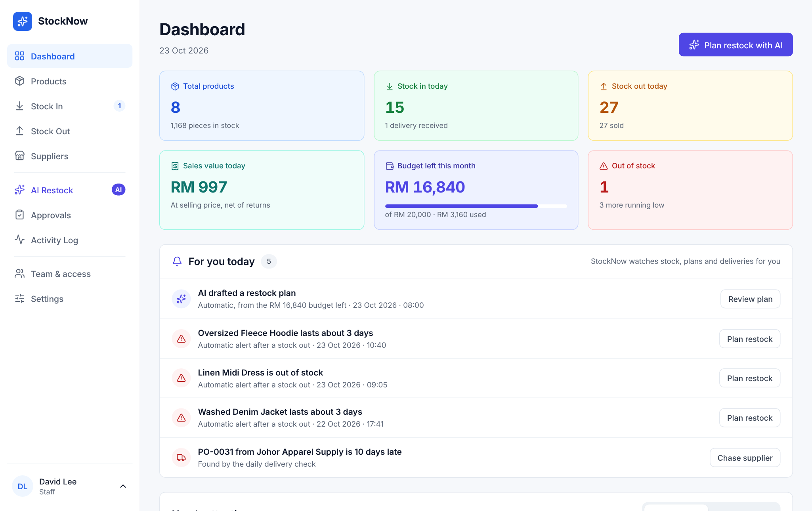
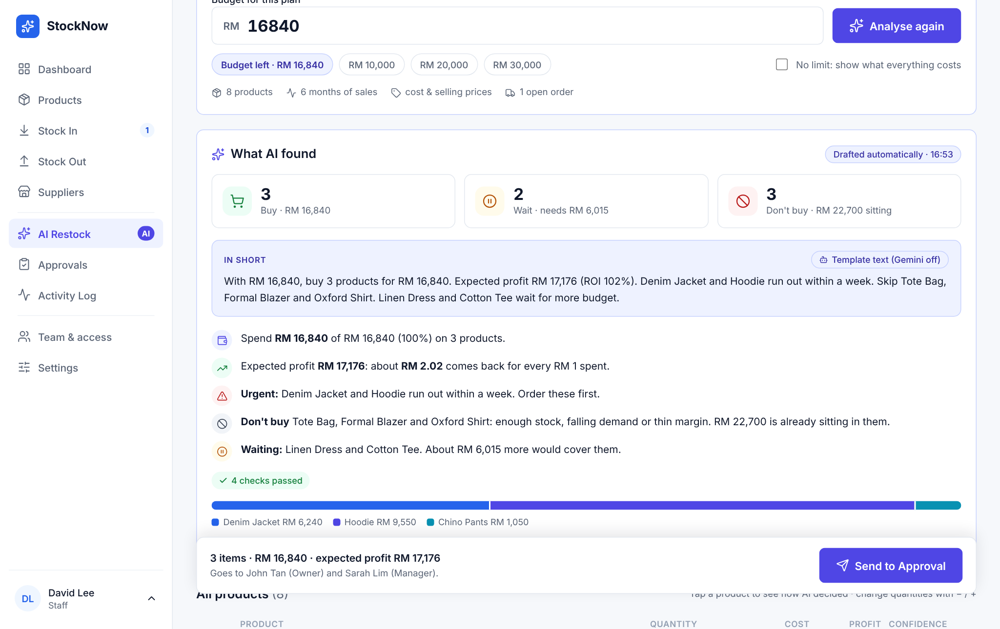
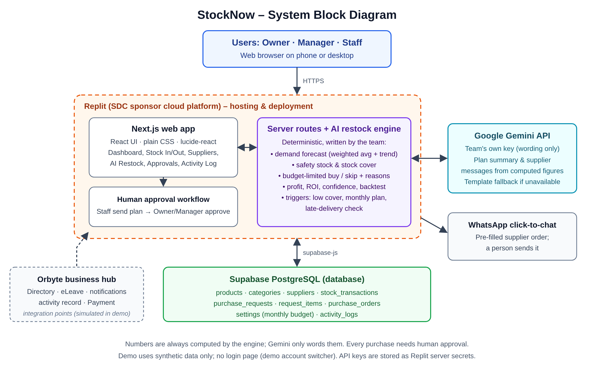

# StockNow

> An inventory app with an AI restock planner that tells small clothing shop owners what to buy, how much, and why, within their monthly budget. The AI suggests; the owner decides.

<p align="center">
  
  &nbsp;
  
</p>

---

## Team Information

| Field                 | Details                                                                                     |
| --------------------- | ------------------------------------------------------------------------------------------- |
| **Team Name**         | Kita Akan Lawan                                                                             |
| **Team Domain**       | Domain 2 (Orbyte Smart SME Challenge: Less Busywork, Better Business)                       |
| **SDG Track**         | SDG 8 (Decent Work and Economic Growth) and SDG 9 (Industry, Innovation and Infrastructure) |
| **Team Leader**       | Alfred Jason Gustono                                                                        |
| **University**        | Xiamen University Malaysia                                                                  |
| **Number of Members** | 5                                                                                           |

## Links

| Resource           | Link                                                                                 |
| ------------------ | ------------------------------------------------------------------------------------ |
| GitHub Repository  | https://github.com/Albrea/Kita-Akan-Lawan-StockNow.git                               |
| Live Demo (Replit) | https://stocknow.replit.app/                                                         |
| Slide Deck         | https://drive.google.com/drive/folders/1M0mmQvDCoiL1j6nfZfzmWxY7rzt96_LC?usp=sharing |
| Demo Video         | https://youtu.be/BaryfPG26D4?si=Bjmmof0Aw0uzXqWQ                                     |

---

## Overview

### Problem

Small shops keep stock, sales and purchasing in separate places: a notebook, a spreadsheet, WhatsApp chats. Every restock means counting items again, guessing what will sell, and checking by hand whether the order fits the money set aside. Guess too low and best-sellers run out; guess too high and cash sits on the shelf as unsold stock. Malaysian MSMEs produce 39.5% of the country's GDP and 48.7% of its jobs (DOSM, 2024), so wasted time and wasted cash here matter.

### Solution

StockNow keeps stock in, stock out, suppliers and the monthly purchase budget in one place. Its **Smart Restock planner** then:

1. **Forecasts** each product's sales for the next 30 days from 6 months of history (a weighted moving average blended with a trend line).
2. **Works out** how many to buy (forecast + safety stock − stock on hand − stock already on order), checks margin and overstock, and **fits the plan into the budget** by urgency and profit.
3. **Explains** every decision in plain words, with expected profit, return on investment and a confidence score. A **Show calculation** view lays out every step of the maths, and an **Accuracy check** backtests the forecast against the latest real month.
4. **Hands the decision to people.** Staff send the plan; the Owner or a Manager approves or rejects each item. Approved items become one order per supplier, and **Gemini** drafts the WhatsApp message.

The numbers come from StockNow's own engine, so they are repeatable and testable. Gemini only writes the wording. If a Gemini reply contains a number the engine did not produce, StockNow discards it and uses a template instead.

### Key Features

- **Smart Restock planner:** buy / wait / don't-buy for every product, fitted to the budget, with reasons, profit, ROI and confidence.
- **Show calculation and Accuracy check:** every number can be traced, and the forecast is backtested on the shop's own sales.
- **Adaptive forecast settings (Smart Restock → Forecast settings):** Gemini reads summary statistics of the shop's sales (never the raw records) and proposes settings for the forecast, such as how much to trust recent months vs the long-term trend and how much safety stock to keep. Settings are shown and typed as plain percentages or days (for example "safety stock 20%", "overstock after 45 days"). StockNow checks the values stay in safe ranges, tests them on past months, and shows the error before and after. Nothing changes until an Owner or Manager approves. In our demo shop the approved settings cut the forecast error from 9.5% to 5.1%.
- **Approval workflow:** Staff send, Owner/Manager approve per item. Nothing is ordered without a person.
- **Supplier orders on WhatsApp:** one order per supplier, a message drafted by Gemini, chasing late deliveries, and receiving partial deliveries.
- **Automatic stock out from Orbyte Payment:** when a customer pays through Orbyte Payment, StockNow records the stock out and the sale by itself. Unknown items or missing stock are handed to the Owner or a Manager to check, never guessed. Duplicates are ignored and refunds put the stock back (simulated in the demo; see [Orbyte Payment interface](#orbyte-payment-interface)).
- **Automatic triggers:** a paid Orbyte order, a low-stock alert after a stock out, a monthly plan drafted on the plan day, and a daily late-delivery check.
- **Undo for stock in and stock out:** adds an opposite entry instead of deleting, so the history and the activity log keep both. Staff can undo their own entries until midnight of the same day; the Owner or a Manager can undo any (while the stock is still there). Undoing a manual purchase gives the budget back; undoing a supplier delivery puts the quantity back on the order and leaves the budget alone, because the order was counted when it was approved.
- **Never lose your place on a delivery:** opening a supplier order (from the Dashboard, a pop-up or a PO code) takes you to it on Stock In and highlights it; quantities typed but not saved are marked, and a "Continue receiving" bar brings you back.
- **Four languages:** English (default), Bahasa Melayu, Tamil and Chinese, chosen per device in Settings → Language.
- **Real dates:** the app runs on today's date in Malaysia; the demo shop is moved to today when it is loaded, so "10 days late" or "lasts 3 days" stay true.
- **Budget that adds up:** supplier orders and manual purchases use it; returns to a supplier refund it; customer returns reduce the day's sales.
- **Roles and departments:** Owner, Manager, and Staff in one of two departments. Inventory staff record stock, receive deliveries and send restock plans; Finance staff only see sales, the budget, supplier orders, approvals and the activity log, and can't change stock. Each person only sees the pages and to-dos for their job. Permissions are checked on the server, not only in the UI.
- **Plain words on screen:** the app calls the planner "Smart Restock" and never says "AI" to shop staff; Gemini is named once, in Settings → Smart features (Owner and Manager only), next to the setup and test button.
- **Activity Log you can search and export:** every stock movement shows SKU, product, stock before / change / after, activity, source (supplier order, manual purchase, sold in store, online order, Orbyte Payment…) and user; other actions (plans, approvals, alerts) are listed alongside. Filter by date range, activity, source and user, search by SKU or product, and export the matching rows as a CSV file that opens in Excel.
- **Finance charts:** Finance staff see two pie charts on their dashboard: last month's sales by product, and the money sitting in stock by category.
- **Show calculation with a chart:** the forecast step has a line chart of sales per month, the trend line and next month's forecast.
- **Outage plan:** offline stock entry that syncs later, a backup copy, and paper/WhatsApp catch-up entry.
- **Six demo scenarios:** mixed, growing, slow season, festive rush, viral product and overstocked, to show how the AI reacts.
- **Responsive:** a sidebar on desktop, a drawer menu and stacked cards on phones. Making the system available on any type of devices.

### Tech Stack

| Layer         | Technology                                                                                                                                            |
| ------------- | ----------------------------------------------------------------------------------------------------------------------------------------------------- |
| Frontend      | Next.js 15 (React 19), JavaScript, plain CSS, lucide-react icons                                                                                      |
| Backend       | Next.js API routes (Node.js); restock engine in plain JavaScript (`lib/engine.js`)                                                                    |
| Database      | Supabase (PostgreSQL), with a built-in in-memory demo store when Supabase is not configured                                                           |
| AI            | Google Gemini API (`gemini-3.5-flash` by default, set with `GEMINI_MODEL`; busy → `gemini-3.5-flash-lite`) for wording only, with a template fallback |
| Hosting / Dev | Replit                                                                                                                                                |
| Tests         | Vitest                                                                                                                                                |

---

## Project Structure

```
.
├── docs                                               # README images
│   ├── screenshots                                    # App screenshots used in the README
│   │   ├── desktop-ai-restock.png                     # Smart Restock plan on desktop
│   │   └── desktop-dashboard.png                      # Dashboard on desktop
│   └── architecture.png                               # System architecture diagram
├── src                                                # All app source code
│   ├── app                                            # Next.js App Router (pages + API)
│   │   ├── api                                        # Server API routes
│   │   │   ├── action                                 # POST: every user action (stock in/out, approve…)
│   │   │   │   └── route.js                           # Validates the action, saves it, returns new state
│   │   │   ├── ai                                     # Gemini endpoints (wording only, never numbers)
│   │   │   │   ├── message                            # Supplier WhatsApp message
│   │   │   │   │   └── route.js                       # Gemini rewords the order message (template fallback)
│   │   │   │   ├── configure                          # Smart Restock → Forecast settings
│   │   │   │   │   └── route.js                       # Gemini proposes settings; checked + backtested
│   │   │   │   ├── status                             # Settings → AI: test that Gemini answers
│   │   │   │   │   └── route.js                       # One small Gemini call; reports model and result
│   │   │   │   └── summary                            # AI restock plan summary
│   │   │   │       └── route.js                       # Gemini explains the plan (template fallback)
│   │   │   ├── orbyte                                 # Orbyte connections
│   │   │   │   └── payment                            # Paid customer orders from Orbyte Payment
│   │   │   │       └── route.js                       # Signed webhook → automatic stock out / refund
│   │   │   └── state                                  # GET: load all shop data
│   │   │       └── route.js                           # Returns data + storage mode + Gemini status
│   │   ├── globals.css                                # All styles, responsive desktop + phone
│   │   ├── icon.svg                                   # Browser tab icon
│   │   ├── layout.js                                  # Root HTML layout, font, metadata
│   │   └── page.js                                    # Home page, renders <App />
│   ├── components                                     # React UI (client side)
│   │   ├── pages                                      # One file per sidebar page
│   │   │   ├── ActivityLog.jsx                        # History of every action by people and AI
│   │   │   ├── AiRestock.jsx                          # Smart Restock planner, accuracy check (main feature)
│   │   │   ├── Approvals.jsx                          # Owner approves plans, creates supplier orders
│   │   │   ├── Dashboard.jsx                          # Alerts, budget left, stock overview
│   │   │   ├── Products.jsx                           # Product list, stock levels, sales trend
│   │   │   ├── Settings.jsx                           # Budget, language, demo data, access, outage test
│   │   │   ├── StockIn.jsx                            # Receive deliveries (PO highlight), undo entries
│   │   │   ├── StockOut.jsx                           # Record sales; Orbyte Payment (simulated)
│   │   │   ├── Suppliers.jsx                          # Supplier list and their orders
│   │   │   └── Team.jsx                               # Team & access, Orbyte connections (simulated)
│   │   ├── App.jsx                                    # App shell: sidebar, account switcher, shared state
│   │   ├── Modals.jsx                                 # Pop-up dialogs (forms, confirmations)
│   │   └── ui.jsx                                     # Small shared UI parts: icons, chips, modal, sparkline
│   └── lib                                            # Logic shared by UI and server
│       ├── server                                     # Server-only code (never sent to the browser)
│       │   ├── gemini.js                              # Calls Gemini (retry once) + number check + fallback
│       │   ├── http.js                                # JSON response helper (keeps Infinity values)
│       │   ├── store.js                               # Saves/loads data: Supabase, or memory if not set
│       │   └── tables.js                              # Maps app fields to Supabase table columns
│       ├── actions.js                                 # Rules for every action + role permissions
│       ├── engine.js                                  # AI forecast, restock plan, budget, backtest, eLeave routing
│       ├── forecast.js                                # Forecast settings: defaults, safe ranges, checks
│       ├── format.js                                  # Money/date formatting, today's date in Malaysia
│       ├── i18n.js                                    # Languages: lookup, dates and month names
│       ├── i18n-dict.js                               # Screen text in Malay, Tamil and Chinese
│       ├── messages.js                                # Supplier WhatsApp message templates
│       └── seed.js                                    # Synthetic demo data (6 scenarios), moved to today
├── submission                                         # Hackathon submission documents
│   ├── Replit Proof of Usage.pdf                      # Proof the app runs on Replit
│   ├── SDC 2026_Kita Akan Lawan_Preliminary.pdf       # Preliminary proposal
│   └── SDC 2026_Kita Akan Lawan_TechDeclaration.pdf   # Technology declaration
├── supabase                                           # Database setup
│   ├── schema.sql                                     # Paste into Supabase SQL Editor: creates 11 tables
│   └── upgrade-final.sql                              # Run once if your tables existed before the final
├── tests                                              # Automated tests (Vitest)
│   ├── actions.test.js                                # Tests actions, permissions, undo, Orbyte Payment
│   ├── engine.test.js                                 # Tests forecast and restock plan
│   ├── forecast.test.js                               # Tests forecast settings, approval, business types
│   ├── gemini.test.js                                 # Tests Gemini use, retry, number check, fallback
│   ├── setup.js                                       # Pins the test clock to 23 Oct 2026
│   └── store.test.js                                  # Tests saving and loading data
├── .env.local.example                                 # Template for secret keys (copy to .env.local)
├── .gitignore                                         # Keeps .env, node_modules, .next off GitHub
├── .replit                                            # Replit run and deploy settings
├── LICENSE                                            # Apache-2.0 license
├── README.md                                          # Project overview + how to run
├── jsconfig.json                                      # Path alias: @/ = src/
├── next.config.js                                     # Next.js settings
├── package-lock.json                                  # Exact dependency versions (auto-generated)
├── package.json                                       # Dependencies and npm scripts (dev, build, start, test)
└── vitest.config.js                                   # Test settings
```

### Architecture

```
Browser (phone / desktop)
        │  HTTPS
        ▼
Replit ── Next.js app ── API routes ── restock engine (lib/engine.js)
                │                 │
                │                 └──► Google Gemini API  (wording only; template if unavailable)
                ▼
        Supabase PostgreSQL  (or the built-in demo store)

Supplier messages open in WhatsApp (wa.me link); a person sends them.
Orbyte Directory, eLeave, notifications and Payment are shown as integration points (simulated in the demo).
```



---

## How to Run

StockNow runs using the built-in demo shop. Add Supabase to keep data permanently, and Gemini for AI-written text.

### Option 1: Run on Replit (recommended)

1. In Replit, choose **Create Repl → Import from GitHub** and paste this repository's URL.
2. _(Optional)_ Open **Secrets** (🔒) and add the variables from `.env.example`:
   - `GEMINI_API_KEY`: from [Google AI Studio](https://aistudio.google.com/apikey)
   - `SUPABASE_URL` and `SUPABASE_SERVICE_ROLE_KEY`: see _Connect Supabase_ below
3. Click **Run**. Replit uses `.replit` to run `npm install && npm run dev`, and the app opens in the Webview on port 3000.
4. To publish, open **Deploy → Autoscale**. Replit builds with `npm run build` and starts with `npm run start`.

> Without Supabase, the demo data lives in server memory and resets when the Repl restarts or scales. Connect Supabase for a deployment that keeps its data.

### Option 2: Run locally

Requires **Node.js 20 or newer**.

```bash
# 1. Clone the repository
git clone https://github.com/Albrea/Kita-Akan-Lawan-StockNow.git stocknow
cd stocknow

# 2. Install dependencies
npm install

# 3. (Optional) Configure environment variables
cp .env.example .env.local      # then fill in your keys

# 4. Start the app
npm run dev                     # open http://localhost:3000
```

Production build: `npm run build` then `npm run start`.

### Connect Supabase (optional)

1. Create a project at [supabase.com](https://supabase.com).
2. Open **SQL Editor**, paste the contents of [`supabase/schema.sql`](supabase/schema.sql), and run it.
3. Go to **Project Settings → API**. Copy the **Project URL** into `SUPABASE_URL` and the **service_role** key into `SUPABASE_SERVICE_ROLE_KEY`.
4. Restart the app. On first start it fills the empty tables with the demo shop. Settings → Backup then shows **Supabase connected**.
5. **Already created the tables before the final-round update?** Run [`supabase/upgrade-final.sql`](supabase/upgrade-final.sql) once in the SQL Editor. It allows the new "Orbyte payment needs a check" alert and adds 3 settings columns (business type, years in business, approved forecast settings). Your existing data is not changed. **Run it before deploying this version**, or saving will fail. To move an older demo shop to today's dates, pick any scenario in **Settings → Demo data**.

The service_role key is only used on the server (API routes). The browser never talks to Supabase, and row-level security is on, so the public anon key can read nothing.

### Run Tests

```bash
npm test
```

54 tests cover the forecast and plan (for example: Hoodie needs 191, confidence 94%, the plan never goes over budget), the budget rules, approvals and permissions, offline mode, undo, Orbyte Payment (duplicates, unknown items, refunds), the move to today's date, adaptive forecast settings (safe ranges, approval, business-type defaults), Gemini (its text is used, a busy server is retried, invented numbers are rejected), and the Supabase storage path (against a fake client). The tests pin the clock to 23 Oct 2026, so their numbers never depend on the day they run.

### Try the demo

There is no login page. Use the **account switcher** at the bottom of the sidebar:

1. As **David Lee (Staff)**: Dashboard → **Plan restock with AI** → review the plan → **Send to Approval**.
2. Switch to **John Tan (Owner)**: Approvals → **Approve & create orders** → **Send order** → **Open in WhatsApp**.
3. Stock In → Supplier orders → **Receive stock** when it "arrives".
4. Smart Restock → **Accuracy check**, or change **Demo data** to see the AI react to a festive rush or an overstocked shop.
5. Stock Out → **Simulate a customer payment**: the stock out is recorded by Orbyte Payment. Choose "An item StockNow doesn't know" to see it handed to the Owner on the Dashboard.
6. Stock In or Stock Out → **Undo** on a recent entry, then open the Activity Log.
7. Settings → **Language** → Bahasa Melayu, Tamil or Chinese.

### Orbyte Payment interface

There is no live Orbyte access in this challenge, so this is our interface assumption. The demo button on Stock Out sends the same event through the app.

**Endpoint:** `POST /api/orbyte/payment`, signed with the shared secret `ORBYTE_WEBHOOK_SECRET`. The header is `x-orbyte-signature: sha256=<hex HMAC-SHA256 of the raw body>`. Unsigned or wrongly signed requests get `401` and change nothing; without the secret the endpoint is off (`503`).

```json
{
  "event": "payment.succeeded",
  "paymentId": "PAY-1001",
  "channel": "in_store",
  "items": [
    { "sku": "TEE-CMB", "qty": 2 },
    { "sku": "ACC-TOT", "qty": 1 }
  ]
}
```

| Situation                                   | What StockNow does                                                                                                       |
| ------------------------------------------- | ------------------------------------------------------------------------------------------------------------------------ |
| Every SKU known and in stock                | One stock out per line (reason "Orbyte Payment PAY-1001"), added to today's sales, logged under **Orbyte Payment**       |
| Unknown SKU, not enough stock, bad quantity | That line is **not** recorded. An alert asks the Owner or a Manager to check, with the reason; they close it with a note |
| Same `paymentId` sent again                 | Ignored (`duplicate: true`), so retries are safe                                                                         |
| `"event": "payment.refunded"`               | The items go back into stock and the sale is removed; a second refund is ignored                                         |

StockNow never moves money: it only reacts to the fact that a payment happened.

### Setup guide

**Dependencies.** Only Node.js is needed (version 20 or newer; Replit uses Node.js 22). `npm install` installs everything listed in `package.json`; nothing has to be installed one by one:

| Package                 | Version | Used for                           |
| ----------------------- | ------- | ---------------------------------- |
| `next`                  | 15.5.28 | Web framework (pages + API routes) |
| `react`, `react-dom`    | 19.2.0  | User interface                     |
| `lucide-react`          | 0.555.0 | Icons                              |
| `@supabase/supabase-js` | 2.117.0 | Database client                    |
| `vitest` _(dev only)_   | 3.2.7   | Tests                              |

**What goes into Supabase.** Only [`supabase/schema.sql`](supabase/schema.sql): paste the whole file into Supabase → SQL Editor → Run, once. Do not insert data by hand. On first start the app sees empty tables and fills them with the demo shop.

**Where the AI's data lives.** The 6 months of sales the forecast uses, the products, prices, stock and suppliers all come from [`src/lib/seed.js`](src/lib/seed.js) (synthetic). With Supabase connected they are copied into the tables (`sales_history`, `products`, …) and read from there. The AI's rules (safety stock 20%, overstock after 45 days, minimum margin 25%, …) are in `ENGINE` at the top of [`src/lib/engine.js`](src/lib/engine.js). You don't need to touch either file. To try other sales stories, use **Settings → Demo data** or the **Demo data** menu on the AI page.

**Gemini model.** The default is `gemini-3.5-flash`. Set `GEMINI_MODEL` to use another one. If the chosen model is overloaded, slow (12 s) or unavailable, StockNow automatically tries `gemini-3.5-flash`, then `gemini-3.5-flash-lite` (change the list with `GEMINI_FALLBACK_MODELS`). In our test on 31 Oct 2026, `gemini-3.8-flash` returned no text within 30 s and reported "high demand", while `gemini-3.5-flash` answered in 1–8 s and `gemini-3.5-flash-lite` in under 1 s. The label on each AI text shows, on hover, which model wrote it.

**Check that Gemini works.** Open **Settings → AI (Gemini) → Test Gemini**. It makes one small call from the server and shows the model and the answer time, or Google's exact error (for example an invalid key or an unknown model). When Gemini writes a text, its label says **Written by Gemini**. If the built-in template is used instead, the label says why: _Gemini not set up_ (no `GEMINI_API_KEY` on the server), _Gemini didn't answer_ (error or timeout, after one retry), or _Gemini's numbers didn't match_ (its reply used a number StockNow didn't calculate). After changing a key in Replit Secrets, redeploy so the server picks it up.

**The `.replit` file.** Replit reads it automatically; you don't run it yourself.

| Line                                 | What it does                                                                      |
| ------------------------------------ | --------------------------------------------------------------------------------- |
| `modules = ["nodejs-20", "web"]`     | Gives the Repl Node.js 20                                                         |
| `run = "npm install && npm run dev"` | What the **Run** button does: install packages, start the dev server on port 3000 |
| `[deployment] build`                 | What **Deploy** runs first: `npm ci && npm run build`                             |
| `[deployment] run`                   | How the deployed app starts: `npm run start`                                      |
| `deploymentTarget = "autoscale"`     | Deployment type (scales to zero when idle)                                        |
| `[[ports]] 3000 → 80`                | Makes the app reachable on the public URL                                         |

**Deploy to Replit, step by step.**

1. Push this project to GitHub.
2. Replit → **Import → Choose 'GitHub'** → choose the repository. Replit detects `.replit`.
3. **Tools → Secrets**: add `GEMINI_API_KEY`, `SUPABASE_URL` and `SUPABASE_SERVICE_ROLE_KEY` (and `GEMINI_MODEL` if you want a different model). `ORBYTE_WEBHOOK_SECRET` is only needed to receive real Orbyte Payment events.
4. Press **Publish** and check the Webview.
5. Enter your project name and wait for the configurations.
6. Click on the **url** and your project is already deployed.

**Check the versions you are using.**

```bash
node -v                      # Node.js
npm -v                       # npm
npx next --version           # Next.js
npm ls next react react-dom lucide-react @supabase/supabase-js vitest
```

`npm ls` prints the exact installed version of each package. The versions requested are in `package.json`, and the exact ones are pinned in `package-lock.json`.

---

## How We Use Replit _(Required)_

- **First Phase:** Used Replit for initial version of prototype and brainstorming before switching to another AI model to make the finalize version.
- **Hosting:** The app is deployed with Replit Deployments at the Live Demo link above. `.replit` defines the run command for development (`npm run dev`) and the build/start commands for the deployment.
- **Secrets:** `GEMINI_API_KEY`, `SUPABASE_URL` and `SUPABASE_SERVICE_ROLE_KEY` are stored in Replit Secrets, never in the code or the repository.

📄 Proof of use:
[`submission/Replit Proof of Usage.pdf`]

---

## Challenges & Learnings

- **Finding a gap Orbyte had not filled.** Our first few ideas were good, but they already existed in some form in the Orbyte ecosystem (eLeave, eClaim, eOT, Attendance, Directory). We learned to study the platform first and to build something that **plugs into** Orbyte instead of rebuilding it.
- **Standing out.** Our mentor pointed out that there is already a lot of software out there, so standing out is hard. It took a lot of brainstorming to land on a clear angle: an AI that explains its numbers and leaves the decision to the owner.
- **Teamwork.** We learned to divide the work better and to manage our time, so design, building, testing and the pitch could move forward in parallel.

## Future Improvements

- [ ] Better integration with Orbyte: real Directory sign-in, eLeave-aware approvals, notifications and Payment for supplier orders
- [ ] Connect to store and marketplace APIs (POS, Shopee, TikTok Shop) so sales flow in automatically
- [ ] Seasonality in the forecast (festive periods such as Raya and year-end sales)
- [ ] Sign-in with row-level security before handling real shop data

## Team

| Name                     | Role                         | GitHub                                             |
| ------------------------ | ---------------------------- | -------------------------------------------------- |
| Alfred Jason Gustono     | Team Lead / Full Stack       | [@AlfredJason78](https://github.com/AlfredJason78) |
| Bartolomeo Arcka Malta   | Full Stack / Pitch Presenter | [@Albrea](https://github.com/Albread)              |
| Valent Budi Prayogo      | Lead Tester                  | [@PrayogoValent](https://github.com/PrayogoValent) |
| Sternt Harbent Chang     | Documentation                | [@Sternt](https://github.com/Sternt)               |
| Nicholas William Soesilo | Pitch Designer               | [@nikuniku06](https://github.com/nikuniku06)       |

---

## Submission Checklist

- [x] Team name, domain (Domain 2) and SDG track filled in
- [x] Slide deck link added
- [x] Demo video link added
- [x] Replit used, with proof of use in `submission/Replit Proof of Usage.pdf`
- [x] Preliminary submission completed (`SDC 2026_Kita Akan Lawan_Preliminary.pdf`)
- [x] Technology declaration completed (`SDC 2026_Kita Akan Lawan_TechDeclaration.pdf`)
- [x] Submission files renamed with the team name
- [x] "How to Run" steps verified
- [x] No API keys or secrets committed to the repository

## License

This project is licensed under the [Apache License 2.0](LICENSE).

_All shop data in this repository (people, suppliers, phone numbers, sales) is synthetic._
